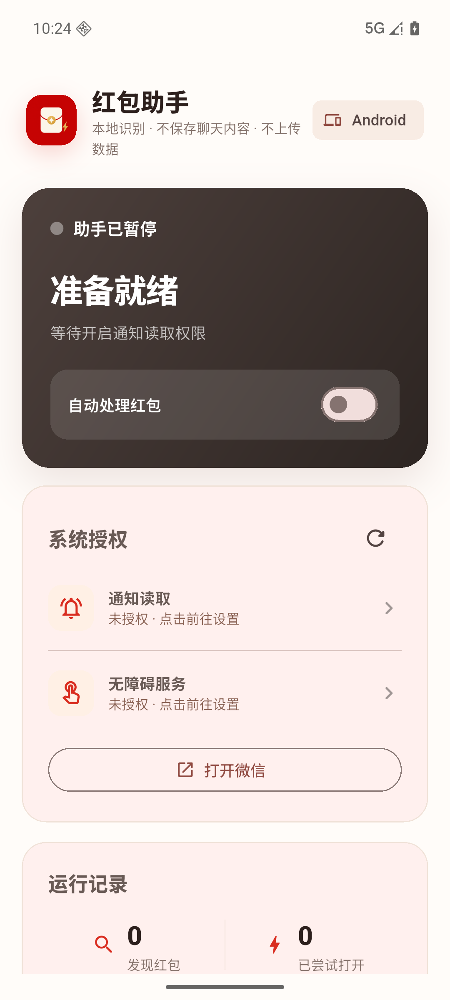
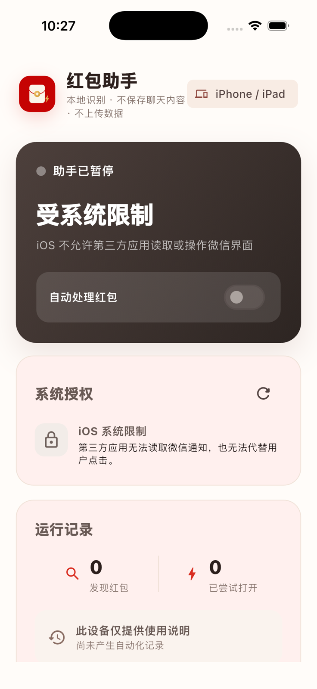
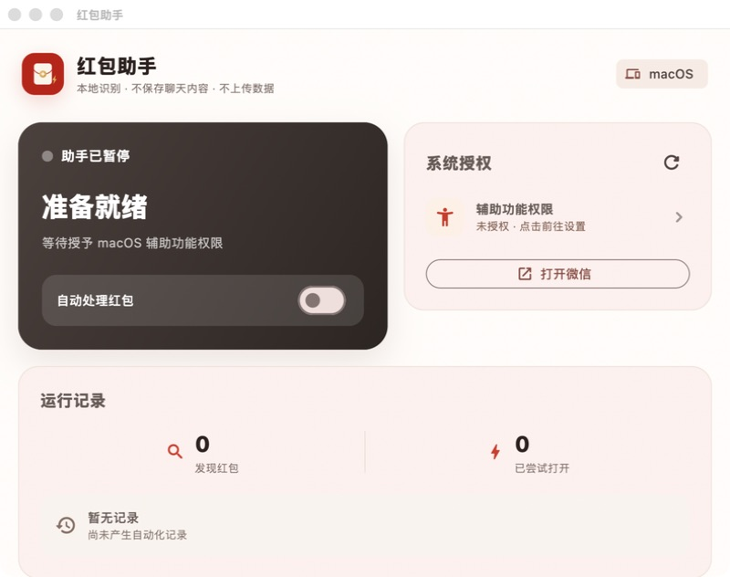

<p align="center">
  
</p>

# Red Packet Assistant

[English](README.md) | [简体中文](docs/README.zh-CN.md)

A local-first, permission-based Flutter companion for detecting WeChat red packets on Android, macOS, and Windows, with an honest informational experience on iOS.

The project never asks for WeChat credentials, never reads the WeChat chat database, and does not upload or persist chat content. Automation is off by default and runs only after the user grants the relevant operating-system permissions and enables it in the app.

> [!IMPORTANT]
> This is an independent community project and is not affiliated with or endorsed by Tencent or WeChat. UI automation is inherently version-sensitive and may be restricted by WeChat, operating-system, or app-store policies. Use it only with your own device and account.

## Platform support

| Platform | Capability | Requirements | Status |
| --- | --- | --- | --- |
| Android | Detects actionable WeChat red-packet notifications, opens the conversation, and clicks exposed packet controls through AccessibilityService | Notification access, accessibility permission, visible notification content | Implemented, tested, and emulator-validated |
| macOS | Combines WeChat's Accessibility tree with on-device ScreenCaptureKit/Vision OCR, then presses exposed packet/open controls | macOS Accessibility and Screen Recording permissions, WeChat running, signed in, and showing the target conversation | Implemented, native-tested, and release-built locally |
| Windows | Combines Raw Windows UI Automation with an in-memory visual detector for custom-drawn packet cards, without process injection | WeChat running, signed in, unobscured, and showing the target conversation | Implemented, screenshot-regression-tested, and Windows-runner tested; live WeChat acceptance remains version-dependent |
| iOS / iPadOS | Runs the dashboard and explains the platform boundary | None | Companion UI only; built and simulator-validated |

WeChat's accessibility tree and labels can change between releases. Detection is best-effort and intentionally avoids private APIs, process injection, jailbreak techniques, or security-control bypasses.

## What it does

- Keeps one shared Flutter dashboard across all four targets.
- Reports the real native permission and runtime state instead of showing a fake “enabled” switch.
- Uses a narrow, deterministic rule: when a packet trigger is visible, try the corresponding packet action.
- Excludes terminal messages such as already claimed, expired, refunded, or empty packets.
- Throttles and fingerprints clicks to avoid repeatedly activating the same control.
- Shows an explicit Android disclosure before sending the user to notification or accessibility settings.
- Stores only local counters and the latest action status; no analytics or network client is included.

## Screenshots

| Android | iOS capability boundary |
| --- | --- |
|  |  |



## Architecture

```text
lib/
  main.dart                          Flutter entry point
  src/app.dart                       Shared responsive dashboard
  src/automation.dart                Native-channel model and client
android/app/src/main/kotlin/.../
  WeChatNotificationListenerService.kt
  RedPacketAccessibilityService.kt
  AutomationState.kt
macos/Runner/MainFlutterWindow.swift  macOS Accessibility + ScreenCaptureKit/Vision bridge
windows/runner/automation_bridge.*    Windows UIA + visible-window capture bridge
windows/runner/visual_detection.h     Windows in-memory color/shape detector
```

The shared layer communicates over the method channel `com.weline.lucky_packet_assistant/automation`. Native implementations expose the same status, settings, launch, and enable/disable operations.

## Validation

- Dart static analysis and all six Flutter tests pass.
- The Android debug APK builds, both native matcher tests pass, and an API 36 emulator cold-launch verified the dashboard, both pre-permission disclosures, the permission guard, and the safe missing-WeChat path.
- The macOS release app builds, and all seven native recognition tests pass, including completed-packet filtering, incoming-card selection, outcome-popup recognition, and the safe second-stage open-button fallback.
- The unsigned iOS device app builds successfully; an iPhone 17 Pro simulator launch verified that automation is disabled and the system boundary is explained.
- Windows compilation and native matcher tests are enforced by the public GitHub Actions workflow. The reported full-resolution Windows screenshots each produce exactly one packet-card region in the same C++ detector used by the runner.

## Quick start

Requirements:

- Flutter 3.47.1 or a compatible stable release
- Dart 3.13 or newer
- JDK 17 and Android SDK Platform/Build Tools 36 for Android
- Xcode with the required Apple platform components for iOS and macOS
- Visual Studio 2022 with **Desktop development with C++** for Windows

Run shared checks:

```bash
flutter pub get
dart analyze lib test
flutter test
```

## Downloads

Versioned development packages are published under [GitHub Releases](../../releases) after a `v*` tag passes every required build:

- Android optimized APK, development-signed for evaluation;
- ad-hoc signed macOS application ZIP with a stable local identity (not Developer ID signed or notarized);
- unsigned Windows application ZIP;
- `SHA256SUMS.txt` for download verification.

An installable iOS IPA is not published because Apple distribution requires project-specific signing credentials. Release packages are convenience builds, not a substitute for reviewing the source or signing your own production distribution.

### Android

```bash
flutter build apk --debug
```

After installation, open the app and grant notification access and accessibility permission. A separate, explicit disclosure is shown before each system-settings handoff. If WeChat notification previews are hidden, the conversation is muted, or background notifications are disabled, packet detection may not receive a useful trigger.

### macOS

```bash
flutter run -d macos
```

Grant the app access under **System Settings → Privacy & Security → Accessibility** and **Screen Recording**, then relaunch Red Packet Assistant. Start and sign in to WeChat, keep the target conversation visible, refresh the dashboard, and enable automation.

The Accessibility path is attempted first. When WeChat does not expose enough control text, the fallback captures only the visible WeChat window and runs Vision OCR locally in memory. It ignores completed/expired packets, retries transient captures, safely derives the circular open-button position only after a packet-popup header is confirmed, and closes the outcome popup after an attempt. No screenshot is saved or uploaded.

The macOS target disables App Sandbox because a sandboxed app cannot provide this cross-app accessibility workflow. It is suitable for local development, self-signing, or Developer ID distribution, but not for the Mac App Store sandbox.

### Windows

```powershell
flutter build windows
```

Start and sign in to WeChat, keep the target conversation visible and unobscured, then enable the assistant. The implementation prefers `InvokePattern`, then the legacy default action and a process-checked clickable point. If WeChat exposes the custom-drawn chat canvas as only a few UIA elements, it captures only the currently visible WeChat window through GDI and detects the orange packet-card component locally in memory. The first scan records existing cards without clicking them; only a newly appearing card is activated. During the packet stage, a separate shape guard accepts a solid gold circular open button but rejects an outline-only close control, then sends Escape after the result appears. Captured pixels are never saved or uploaded, and the app does not inject code into WeChat.

### iOS

```bash
flutter build ios --no-codesign
```

The iOS target deliberately remains a companion/status experience. It does not use private APIs, jailbreak interfaces, or claim cross-app automation that an ordinary iOS application cannot provide.

## Privacy and security

Read [PRIVACY.md](PRIVACY.md), [SECURITY.md](SECURITY.md), and [DISCLAIMER.md](DISCLAIMER.md) before distributing a build.

Android AccessibilityService use must remain narrow, clearly disclosed, consented to, and accurately declared in Play Console. This repository includes the in-app disclosure, but a distributor is still responsible for store declarations, privacy policy, data-safety answers, signing, and current policy compliance.

## Contributing

Issues and pull requests are welcome. See [CONTRIBUTING.md](CONTRIBUTING.md) for setup, testing, and platform-specific contribution rules.

## License

Released under the [MIT License](LICENSE).

## Release checklist

- Configure a private Android release keystore; the repository never includes signing keys.
- Configure an Apple Developer Team, unique bundle identifier, signing, and notarization as applicable.
- Sign the Windows executable or MSIX for public distribution.
- Re-test against the exact WeChat version being targeted.
- Re-check WeChat and distribution-channel policies before every release.
