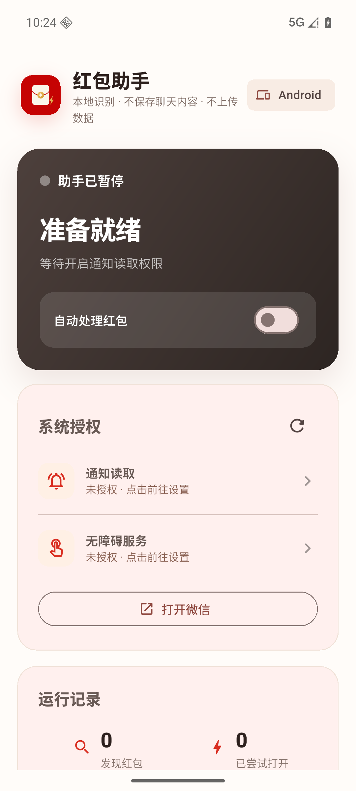
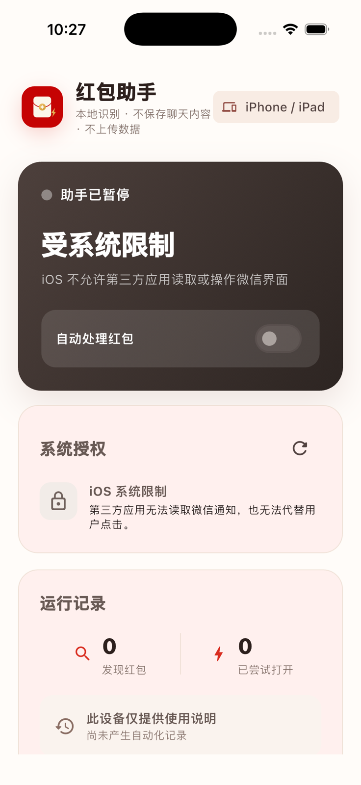
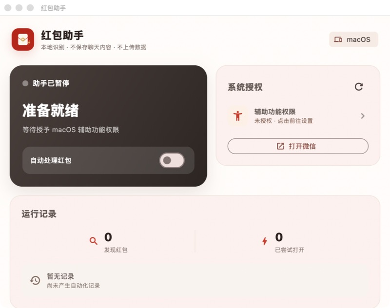

<p align="center">
  
</p>

# 红包助手

[简体中文](../README.md) | [English](../README.en.md)

一个本地优先、基于用户授权的 Flutter 微信红包辅助项目。Android、macOS 和 Windows 提供尽力而为的红包识别与操作；iOS 提供诚实的状态和能力说明界面。

项目不要求微信账号或密码，不读取微信聊天数据库，不上传或持久化聊天内容。自动化默认关闭，只有用户主动授予系统权限并在应用内开启后才运行。

> [!IMPORTANT]
> 本项目是独立社区项目，与腾讯或微信不存在隶属、合作或背书关系。界面自动化依赖具体微信版本，也可能受到微信、操作系统或应用商店规则限制。请仅在自己的设备和账号上使用。

## 平台能力

| 平台 | 当前能力 | 必要条件 | 状态 |
| --- | --- | --- | --- |
| Android | 识别可领取的微信红包通知、打开对应会话，并通过无障碍服务点击系统可见的红包控件 | 通知读取、无障碍权限、通知正文可见 | 已实现、通过测试并完成模拟器验收 |
| macOS | 结合微信辅助功能树与本机 ScreenCaptureKit/Vision OCR，按下可见的红包/“开”控件 | macOS 辅助功能和屏幕录制权限、微信已登录且目标会话可见 | 已实现、通过原生测试并完成本地 Release 构建 |
| Windows | 结合 Windows UI Automation Raw 视图与本地内存视觉检测处理微信自绘红包卡片，不注入微信进程 | 微信已登录运行、窗口无遮挡且目标会话可见 | 已实现、通过截图回归与 Windows runner 测试；真实微信验收仍依赖具体版本 |
| iOS / iPadOS | 运行统一仪表盘并说明平台边界 | 无 | 仅辅助说明；已完成构建和模拟器验收 |

微信的控件标签和辅助功能结构会随版本变化，因此识别属于尽力而为。项目明确不使用私有 API、进程注入、越狱接口或绕过系统安全控制的方案。

## 功能特点

- 四个平台共享同一套响应式 Flutter 仪表盘。
- 展示真实原生权限和运行状态，不伪造“已开启”。
- 规则固定且范围明确：发现红包触发后，只尝试对应的红包动作。
- 排除“已领取”“已领完”“已过期”“已退款”等终态文本。
- 对点击进行节流和指纹去重，避免反复触发同一控件。
- Android 在跳转通知和无障碍设置前展示独立披露并要求主动同意。
- 仅保留本地计数和最近一次动作状态；项目不包含分析统计或网络上报客户端。

## 界面预览

| Android | iOS 能力边界 |
| --- | --- |
|  |  |



## 项目结构

```text
lib/
  main.dart                          Flutter 入口
  src/app.dart                       共享响应式界面
  src/automation.dart                原生通道模型与客户端
android/app/src/main/kotlin/.../
  WeChatNotificationListenerService.kt
  RedPacketAccessibilityService.kt
  AutomationState.kt
macos/Runner/MainFlutterWindow.swift  macOS Accessibility + ScreenCaptureKit/Vision 桥接
windows/runner/automation_bridge.*    Windows UIA + 可见窗口捕获桥接
windows/runner/visual_detection.h     Windows 内存颜色/形状检测器
```

共享层通过 `com.weline.lucky_packet_assistant/automation` 方法通道通信，各原生端提供一致的状态、系统设置、打开微信和启停操作。

## 验收结果

- Dart 静态分析和 6 项 Flutter 测试全部通过。
- Android Debug APK 构建成功，2 项原生匹配器测试通过；并在 API 36 模拟器冷启动验证了仪表盘、两类授权前披露、权限防误开及未安装微信时的安全提示。
- macOS Release 应用构建成功，7 项原生识别测试全部通过，覆盖已领完过滤、新红包选择、结果弹窗识别，以及红包弹窗第二阶段“开”按钮的安全兜底。
- iOS 无签名设备构建成功；并在 iPhone 17 Pro 模拟器启动验证了自动化保持禁用、系统能力边界说明准确。
- Windows 编译和原生匹配策略测试由公开仓库的 GitHub Actions 强制执行；用户报告的两张全分辨率 Windows 截图在 runner 使用的同一套 C++ 检测器中都精确产生 1 个红包卡片区域。

## 快速开始

环境要求：

- Flutter 3.47.1 或兼容稳定版
- Dart 3.13 或更高版本
- Android：JDK 17、Android SDK Platform 36、Build Tools 36
- Apple 平台：Xcode 及对应 iOS/macOS 平台组件
- Windows：Visual Studio 2022“使用 C++ 的桌面开发”工作负载

运行共享检查：

```bash
flutter pub get
dart analyze lib test
flutter test
```

## 下载版本包

带版本号的开发包会在 `v*` 标签通过全部必要构建后发布到 [GitHub Releases](../../../releases)：

- Android 优化 APK，使用开发签名，仅供本人设备评估；
- 未签名的 iOS IPA，供使用自己的 Apple 证书和描述文件重新签名；
- 使用稳定本地身份临时签名的 macOS 应用 ZIP（未使用 Developer ID 签名，也未公证）；
- 未签名的 Windows 应用 ZIP；
- 用于校验下载文件的 `SHA256SUMS.txt`。

iOS IPA 不能直接安装到普通设备：Apple 分发需要项目专属签名凭据，必须先使用自己的证书和描述文件重新签名。Release 中的版本包只为方便测试，不能替代源码审查或自行完成正式签名。

### Android

```bash
flutter build apk --debug
```

安装后在应用内分别开启通知读取和无障碍权限。每次跳转系统设置前都会展示独立、明确的数据访问说明并要求用户主动同意。如果微信关闭通知详情、群聊免打扰或系统禁用后台通知，应用可能无法获得有效触发信息。

### macOS

```bash
flutter run -d macos
```

在“系统设置 → 隐私与安全性 → 辅助功能”和“屏幕录制”中允许红包助手，然后重新启动红包助手。启动并登录微信，让目标会话保持可见，回到应用刷新状态后开启自动化。

程序会优先使用辅助功能树；当微信没有暴露足够的控件文本时，仅截取当前可见的微信窗口，并在内存中使用 Vision OCR 本地识别。它会跳过已领完/已过期红包、重试暂时失败的截图；仅在确认红包弹窗标题后安全推导圆形“开”按钮位置，并在尝试后关闭结果弹窗。截图不会保存或上传。

macOS 目标为了访问其他应用的辅助功能树关闭了 App Sandbox，适合本地开发、自签名或 Developer ID 分发，不符合 Mac App Store 沙盒要求。

### Windows

```powershell
flutter build windows
```

启动并登录微信，让目标会话保持可见且无遮挡后开启助手。Windows 端优先请求 `InvokePattern`，再尝试旧版辅助功能默认动作和经过微信进程校验的点击点。当微信把自绘聊天区只暴露成少量 UIA 元素时，程序仅通过 GDI 捕获当前可见的微信窗口，并在本地内存中识别橙色红包卡片。首次扫描只登记现有红包而不点击，之后只处理新出现的卡片；进入红包阶段后，另一条形状保护只接受实心金色圆形“开”按钮。领取后仅点击经过位置与轮廓确认的关闭控件，不再发送全局 `Esc`；若微信被隐藏或最小化，助手会恢复主窗口后继续监测。捕获像素不会保存或上传，程序也不会向微信进程注入代码。

### iOS

```bash
flutter build ios --no-codesign
```

iOS 目标只提供辅助和状态界面，不使用私有 API、越狱接口，也不宣称普通 iOS 应用无法实现的跨应用自动化。

GitHub Releases 附带的 IPA 未签名，尝试安装前必须使用自己的 Apple 开发证书和描述文件重新签名。

## 隐私与安全

公开分发前请阅读 [隐私说明](PRIVACY.zh-CN.md)、[安全政策](SECURITY.zh-CN.md) 和 [免责声明](../DISCLAIMER.md)。

Android AccessibilityService 必须保持用途有限、披露清晰、取得主动同意，并在 Play Console 中如实申报。本仓库已包含应用内披露，但发布者仍需自行完成商店申报、隐私政策、数据安全问卷、签名和最新政策核对。

## 参与贡献

欢迎提交 Issue 和 Pull Request。开发环境、测试方式和各平台约束见 [简体中文贡献指南](CONTRIBUTING.zh-CN.md)。

## 开源许可证

项目采用 [MIT License](../LICENSE) 开源。

## 发布检查

- 配置私有 Android release keystore；仓库不得包含任何签名密钥。
- 根据需要配置 Apple Developer Team、唯一 Bundle ID、签名和公证。
- 对公开分发的 Windows EXE 或 MSIX 进行代码签名。
- 针对计划支持的准确微信版本重新验收。
- 每次发布前重新检查微信和目标分发渠道的最新规则。
